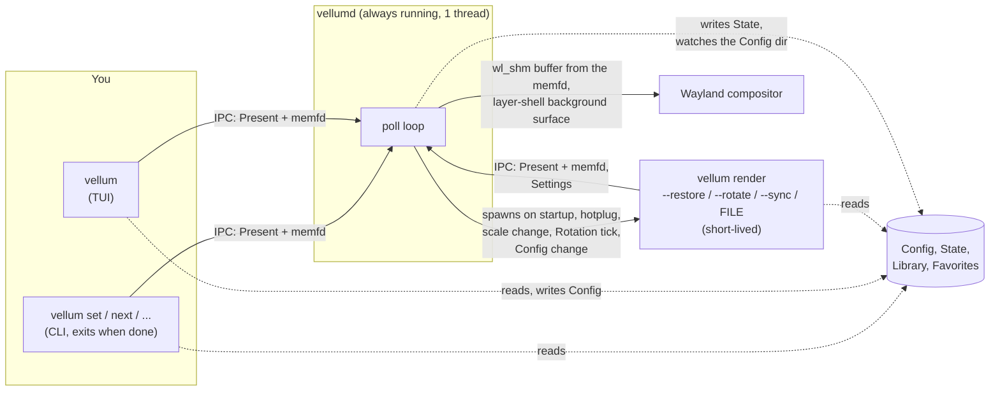
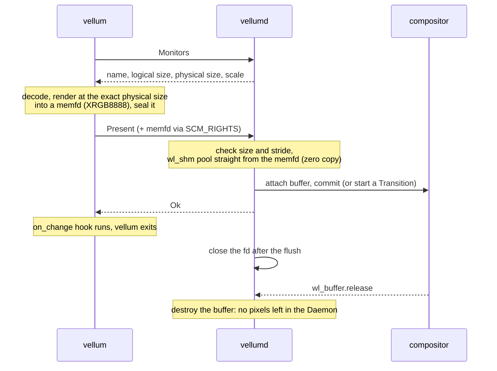

# Architecture

How Vellum is put together, for contributors. Domain words (Monitor,
Daemon, Transition, Rotation, State, Config, ...) mean exactly what
[GLOSSARY.md](GLOSSARY.md) says. The decisions behind the design are in
[docs/adr/](docs/adr/).

## The idea in one paragraph

The process that runs all day should be as small as possible, so it does
almost nothing. `vellumd`, the Daemon, owns the Wayland connection, one
background surface per Monitor and a few timers. It has no image decoders,
never parses the Config and never holds pixels. Everything heavy (decoding,
scaling, choosing the next wallpaper, reading the Config) happens in
`vellum`, a normal command that exits when it is done and takes its memory
with it. When the Daemon needs a frame it doesn't have, it starts a
short-lived `vellum render` to make one.

## Process model

- **`vellumd`** is single-threaded. One `poll` over the Wayland socket, the
  IPC listener, an inotify fd on the Config directory, a timerfd for
  Rotation deadlines, and a pidfd for each `vellum render` child. The poll
  timeout is infinite, so an idle Daemon never wakes up. Transitions are
  paced by `wl_surface.frame` callbacks, not by a timer.
- **`vellum`** is the CLI, the TUI and the renderer in one binary. Any user
  command auto-starts `vellumd` if no socket answers (`client::daemon()`).
- **`vellum render`** is a hidden subcommand the Daemon runs:
  `--restore -m NAME` puts the State wallpaper back on a Monitor,
  `--rotate --ticket N -m NAME...` picks and presents the next Rotation
  wallpaper, and
  `--sync` reads the Config and pushes its settings to the Daemon.
  `render FILE -m NAME` presents an explicit file with `set FILE -m NAME`'s
  effects (Config Fit mode and Transition, State, `on_change` hook,
  Rotation timer reset), but no Library lookup. Like every `render` mode
  it never starts a Daemon, and it exits right after presenting.
- **One Daemon per Wayland display**, enforced by an flock next to the
  socket. The Daemon exits when the compositor goes away; under systemd
  (`Type=notify`, `Restart=on-failure`) it comes back with the session.

## IPC

`vellum-ipc` is the only place the wire format lives. The socket is
`$XDG_RUNTIME_DIR/vellum-$WAYLAND_DISPLAY.sock`. Each connection carries one
request and one response.

Every message is a 12-byte little-endian header followed by a payload:

| Bytes | Field |
|---|---|
| 0..4 | magic `VLUM` |
| 4..6 | protocol version (`PROTOCOL_VERSION`) |
| 6..8 | message kind |
| 8..12 | payload length (at most 1 MiB) |

Payloads are hand-encoded (no serde), so the Daemon stays lean. A version
mismatch is reported with both versions and a hint to restart the Daemon.

| Family | Kinds | Purpose |
|---|---|---|
| Query `0x01xx` | `Monitors`, `Status` | Monitor sizes and scales; what each Monitor shows, Rotation, Daemon RSS |
| Present `0x02xx` | `Present` | A frame for one Monitor, plus Transition, Fit mode, source path and origin |
| Settings `0x03xx` | `Settings` | Transition defaults and Rotation schedule, pushed from the Config |
| Rotation `0x04xx` | `RotationStart`, `RotationStop` | Control the timers |
| Lifecycle `0x05xx` | `Kill` | Stop the Daemon |
| Responses `0x80xx` | `Ok`, `Dropped`, `Error`, `Monitors`, `Status` | Replies |

Pixels never travel in a payload. They go as a memfd passed with
`SCM_RIGHTS` next to the `Present` message.

Every `Present` names its origin, which decides when a late frame is
dropped (answered `Dropped`, and the sender acts as if it never presented):

| Origin | Sent by | Dropped when |
|---|---|---|
| `Manual` | `set`, `next`/`prev`/`random`, the TUI, `render FILE` | never; showing it restarts that Monitor's Rotation timer in the same step |
| `Restore` | `render --restore` | the Monitor already has a frame of its current size |
| `Rotate(ticket)` | `render --rotate` | that Monitor had a `Manual` frame after the Daemon issued the tick's ticket |
| `Repaint` | `render --sync` (new letterbox color) | never, and it is not a manual apply |

So a tick that fires while `vellum set` is in flight can never replace the
pick, whichever frame reaches the Daemon first.

## Frame lifecycle

1. `vellum` asks for the Monitors and renders each frame at the Monitor's
   physical size: logical size times the fractional scale, so it is
   pin-sharp. The same pure function, `render::render`, draws the TUI
   preview, so the preview always matches the result.
2. The frame is a sealed memfd. The Daemon turns it into a `wl_shm` pool
   directly, attaches and commits, and closes its fd right after the flush.
3. On `wl_buffer.release` it destroys the buffer. The Daemon never keeps a
   CPU copy of a frame, and pixel memory never lands on its heap.
4. A Transition is a desync subsurface over the background surface. Fade
   ramps `wp_alpha_modifier_v1` (the compositor blends on the GPU), or
   without that protocol does a short CPU blend into two alternating
   buffers. Wipe and Slide only move viewport rectangles or the subsurface
   position. Every temporary buffer is freed at the end.
5. A viewport shows the frame at the logical size. On a scale change the
   old frame stays on screen, stretched, until the re-rendered one arrives,
   so the screen never flashes black.
6. After a successful Present the Daemon records the wallpaper in State, so
   it can restore it at the next start, on hotplug and after a scale change.

## Crate map

| Crate | Binary | What lives there |
|---|---|---|
| [`vellum-ipc`](crates/vellum-ipc) | (library) | The protocol: header codec, `Request`/`Response`, socket transport with fd passing, socket and Config paths |
| [`vellumd`](crates/vellumd) | `vellumd` | The Daemon: Wayland, Transitions, State, Rotation timers, Config watch |
| [`vellum`](crates/vellum) | `vellum` | CLI, TUI, renderer, Config, Library, Rotation rules, Favorites, hook |

### `vellumd`

| Module | Role |
|---|---|
| `main.rs` | Arguments, startup order (lock, Wayland, socket, sd_notify) |
| `daemon.rs` | The poll loop and the answer to every request |
| `wayland.rs` | Monitors, layer surfaces, viewports, fractional scale, `present()` (on [waybackend](docs/adr/0004-waybackend-over-wayland-client.md)) |
| `wayland/transition.rs` | Fade, Wipe and Slide on frame callbacks |
| `ipc.rs` | The listening socket and one-shot clients |
| `state.rs` | State: wallpaper per Monitor, Rotation running flag and deadlines |
| `rotation.rs` | Pure Rotation timer bookkeeping (wall-clock deadlines) |
| `config_watch.rs` | inotify on the Config directory, symlinks followed |
| `system.rs` | Display lock, sd_notify, timerfd, spawning `vellum render` |

`protocols/` holds the vendored Wayland XML and `build.rs` generates the
bindings. `vellumd/tests/daemon.rs` fails the build if an image decoder,
toml or serde ever shows up in the Daemon's dependency tree.

### `vellum`

| Module | Role |
|---|---|
| `main.rs` | clap commands |
| `client.rs` | Talking to the Daemon, auto-start, `kill` |
| `set.rs`, `restore.rs`, `sync.rs` | Presenting a wallpaper; `render --restore`; `reload` and `render --sync` |
| `decode.rs`, `render.rs`, `frame.rs` | Decode any format, the pure render function with the four Fit modes, the memfd frame |
| `config.rs`, `config/edit.rs` | Parse and validate the Config with precise errors; comment-preserving edits from the TUI |
| `library.rs` | Scanning the Library, resolving names |
| `rotation.rs`, `deck.rs`, `favorites.rs` | `next`/`prev`/`random`/`render --rotate`, the shuffle decks, Favorites |
| `hook.rs` | `on_change`: split once, substitute, run without a shell |
| `monitors.rs`, `status.rs`, `docs.rs` | `vellum monitors`, `vellum status`, completions and man pages |
| `tui/` | The TUI (below) |

### The TUI

`tui/` follows the Elm architecture. `model.rs` is plain data, `msg.rs`
holds `Msg` (what happened) and `Cmd` (work to do, as data),
`update.rs` is `update(&mut Model, Msg) -> Vec<Cmd>`, and `view.rs` is a pure
function of the Model. `runtime.rs` is the only impure part: an input
thread, a small worker pool, timers, and a redraw only when the Model is
dirty. `services.rs` performs Cmds against the real world, and
`harness.rs` swaps in a fake for tests. `keymap.rs` is one table of Actions
that drives key lookup, the footer, the `?` help and the `:` palette.
`preview.rs` and `cache.rs` render previews and keep them in memory and on
disk.

## Where state lives

| What | Where | Written by |
|---|---|---|
| Config | `$XDG_CONFIG_HOME/vellum/config.toml` | you, and the TUI |
| Last good Config | `$XDG_STATE_HOME/vellum/config.last-good.toml` | `vellum reload`, `render --sync` |
| State | `$XDG_STATE_HOME/vellum/state` | `vellumd` |
| Rotation decks | `$XDG_STATE_HOME/vellum/rotation` | `vellum` |
| Favorites | `$XDG_DATA_HOME/vellum/favorites` | `vellum` |
| Preview cache | `$XDG_CACHE_HOME/vellum/thumbs/` | the TUI |
| Daemon log (auto-started) | `$XDG_STATE_HOME/vellum/vellumd.log` | `vellumd` |

## Decisions

- [ADR 0001](docs/adr/0001-clean-room-rewrite-and-relicense.md): a clean-room rewrite, relicensed MIT OR Apache-2.0
- [ADR 0002](docs/adr/0002-static-wallpapers-only.md): still images only
- [ADR 0003](docs/adr/0003-decoder-free-pixel-free-daemon.md): the Daemon holds no decoders and no pixels
- [ADR 0004](docs/adr/0004-waybackend-over-wayland-client.md): waybackend instead of wayland-client

Measured footprint and the CI gates that keep it: [docs/benchmarks.md](docs/benchmarks.md).
