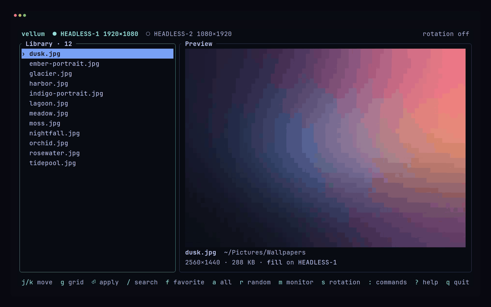

<div align="center">


# Vellum

**Wallpapers, weightless.**

A wallpaper Daemon for Wayland that idles at 2.5 MiB with zero wakeups,<br>
plus smooth Transitions, Rotation and a TUI for browsing your Library.

[](https://github.com/CPT-Dawn/Vellum/releases/latest)
[](https://github.com/CPT-Dawn/Vellum/actions/workflows/ci.yml)
[](https://aur.archlinux.org/packages/vellum-bin)
[](#license)

[Install](#install) · [Quick start](#quick-start) · [Documentation](docs/README.md) · [Contributing](CONTRIBUTING.md)



<sub><a href="assets/demo.mp4">Watch in full quality</a></sub>

</div>

## Why Vellum

- **A Daemon you forget is running.** `vellumd` is one 485 KiB thread that
  links no image decoders and keeps no pixels, so it stays at its idle
  footprint after every Transition.
- **Smooth Transitions.** Fade, Wipe and Slide advance on each Monitor's own
  frame callbacks, and the compositor does the Fade's blend where it can.
- **Pin-sharp, every time.** Each wallpaper is rendered at the Monitor's
  exact physical resolution, fractional scaling included, and comes back
  after a reboot, a hotplug or a scale change.
- **Rotation and Favorites.** Shuffle or step through your Library or your
  Favorites on a timer, with a different pace per Monitor.
- **A TUI worth opening.** Thumbnail grid, true-to-Monitor previews, fuzzy
  search, mouse support and remappable keys.

| Daemon | Idle RSS | Wakeups/min idle | RSS after a Transition |
|---|---|---|---|
| **vellumd 2.0** | **2.5 MiB** | **0** | **2.5 MiB** |
| awww 0.12.1 | 2.7 MiB | 0 | 26 MiB |
| swaybg 1.2.2 | 17 MiB | 0 | n/a |
| hyprpaper 0.8.4 | 239 MiB | 12 | n/a |

<sub>Hyprland, two Monitors, a 3840x2160 wallpaper. Method, script and a headless run in [docs/benchmarks.md](docs/benchmarks.md).</sub>

## Install

```sh
paru -S vellum-bin
```

<details>
<summary>Other ways to install</summary>

**AUR, built from source**

```sh
paru -S vellum
```

**Release tarballs** for x86_64 and aarch64 Linux are on
[GitHub Releases](https://github.com/CPT-Dawn/Vellum/releases/latest), with
the systemd user unit, completions and man pages.

**From source** (needs Rust 1.99 or newer)

```sh
git clone https://github.com/CPT-Dawn/Vellum && cd Vellum
cargo install --locked --path crates/vellumd
cargo install --locked --path crates/vellum
```

</details>

Vellum runs on Hyprland, niri, Sway and the other Wayland compositors with
wlr-layer-shell. GNOME and X11 are not supported.
[docs/installation.md](docs/installation.md) has AVIF and JXL support.

## Quick start

1. Start the Daemon with your session, using the line for your compositor:

   ```text
   exec-once = vellumd                      # Hyprland: hyprland.conf
   spawn-at-startup "vellumd"               # niri: config.kdl
   exec vellumd                             # Sway: config
   systemctl --user enable --now vellumd    # systemd, any compositor
   ```

2. Set a wallpaper. Any `vellum` command starts the Daemon if it isn't running.

   ```sh
   vellum set ~/Pictures/Wallpapers/dunes.jpg
   ```

3. Run `vellum` to open the TUI on `~/Pictures/Wallpapers`. Press
   <kbd>Enter</kbd> to apply, <kbd>m</kbd> to target the next Monitor and
   <kbd>s</kbd> to start Rotation.

Your wallpapers now come back at every login. Press <kbd>?</kbd> in the TUI
for every key, and run `vellum help` for every command.

## Documentation

| Guide | What it covers |
| --- | --- |
| [Installation](docs/installation.md) | Every channel, autostart per compositor, optional formats |
| [Commands](docs/cli.md) | Every `vellum` command and flag |
| [Configuration](docs/configuration.md) | Every Config key and its default, the change hook, the keymap |
| [Troubleshooting](docs/troubleshooting.md) | GNOME, animated wallpapers, where files live, the log |
| [Architecture](ARCHITECTURE.md) | How the Daemon, the CLI and the TUI fit together |
| [Changelog](CHANGELOG.md) | What changed in each release |

## Contributing

Bug reports and patches are welcome. [CONTRIBUTING.md](CONTRIBUTING.md) has
the setup, the checks CI runs, a sandbox that never touches your desktop, and
how the demo is recorded.

## License

Licensed under either of [Apache-2.0](LICENSE-APACHE) or [MIT](LICENSE-MIT)
at your option. © CPT-Dawn
