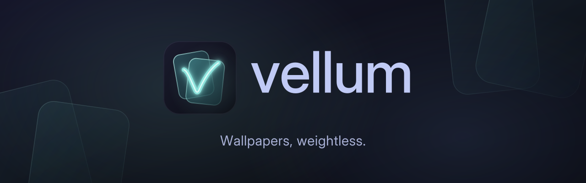
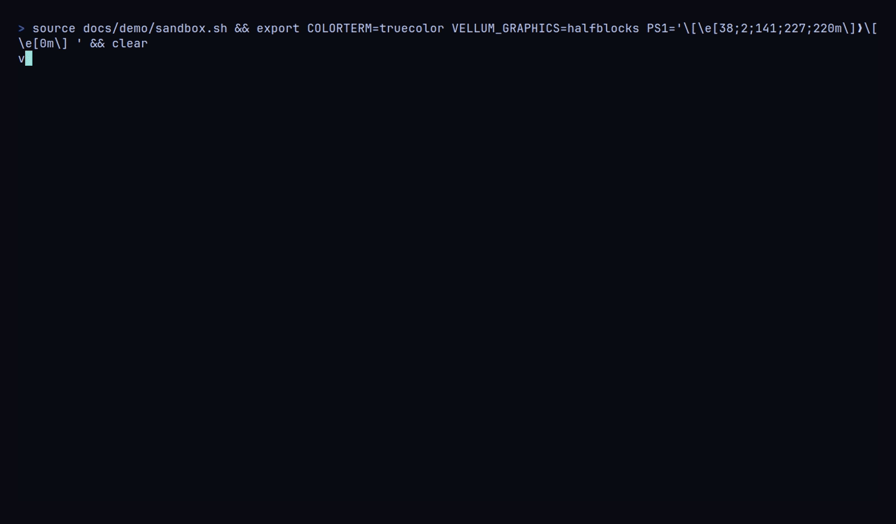
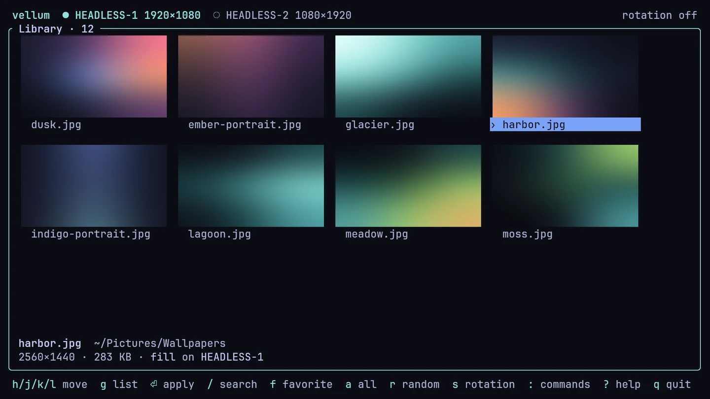
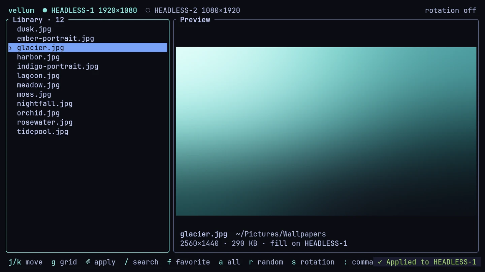
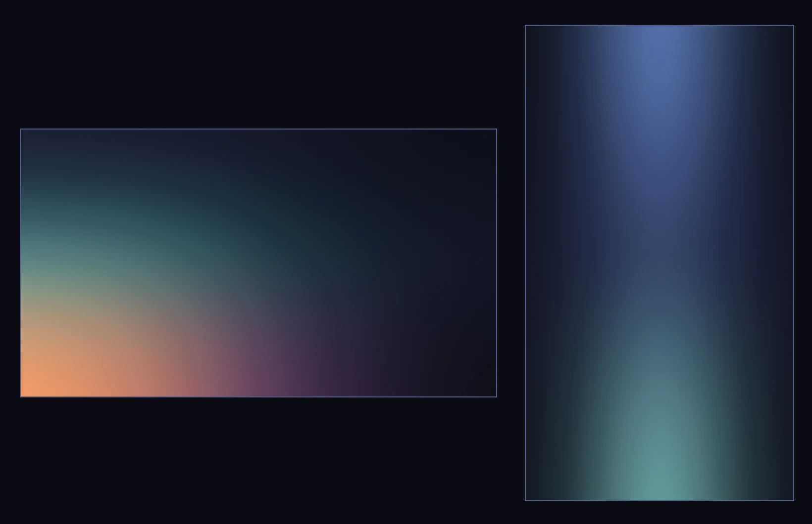

<p align="center"></p>

<h3 align="center">Wallpapers, weightless.</h3>

<p align="center">
A featherweight wallpaper Daemon for Wayland, with smooth Transitions, Rotation and a TUI you'll actually enjoy.
</p>

<!-- Demo GIF: run `vhs docs/demo/demo.tape` (see docs/demo/), then uncomment.
<p align="center"></p>
-->

<p align="center">


</p>
<p align="center">

</p>

- **Tiny Daemon.** `vellumd` is one thread, links no image decoders and keeps
  no pixels. It idles at 2.5 MiB RSS with zero wakeups.
- **Smooth Transitions.** Fade, Wipe and Slide, paced by your Monitor's own
  refresh rate, with the blend done by the compositor where it can.
- **Pin-sharp.** Every wallpaper is rendered at the Monitor's exact physical
  resolution, fractional scaling included, in one of four Fit modes.
- **Remembers.** Wallpapers come back after a reboot, a hotplug or a scale
  change, without a flash of black.
- **Rotation and Favorites.** Shuffle or step through your Library or your
  Favorites on a timer, with per-monitor Overrides.
- **A real TUI.** Thumbnail grid, true-to-monitor previews, fuzzy search,
  mouse support and remappable keys.
- **Works without a Config.** Every setting has a default, and changes to
  the Config apply live.

Vellum is built for Hyprland, niri, Sway and the other Wayland compositors
that support wlr-layer-shell. The screenshots are real, captured with grim
from a headless Sway.

## Footprint

Measured on headless Sway with two Monitors (2560x1440 and 1920x1080) and a
3840x2160 wallpaper. [docs/benchmarks.md](docs/benchmarks.md) has the method
and the script, so you can rerun it on your machine.

| Daemon | Binary | Idle RSS | Idle private | Wakeups/min idle | RSS after a Transition | Threads |
|---|---|---|---|---|---|---|
| vellumd 2.0 | 480 KiB | 2.5 MiB | 0.6 MiB | 0 | 2.5 MiB | 1 |
| swaybg | pending | pending | pending | pending | n/a | pending |
| hyprpaper | pending | pending | pending | pending | n/a | pending |
| awww | pending | pending | pending | pending | pending | pending |

The comparison rows are pending a benchmark run with those daemons
installed.

## Install

**Arch Linux** (AUR, builds from source):

```sh
paru -S vellum
```

**Prebuilt binaries** for x86_64 and aarch64 Linux are on
[GitHub Releases](https://github.com/CPT-Dawn/Vellum/releases). Each tarball
has `vellum`, `vellumd`, the systemd user unit, shell completions and man
pages. Put the two binaries on your `PATH`.

**From source** with Rust 1.99 or newer:

```sh
git clone https://github.com/CPT-Dawn/Vellum && cd Vellum
cargo install --locked --path crates/vellumd
cargo install --locked --path crates/vellum
```

From crates.io, once 2.0.0 is published (the `vellum` crate name was taken,
so the package is `vellum-wallpaper`; the command is still `vellum`):

```sh
cargo install --locked vellumd vellum-wallpaper
```

AVIF and JXL support are opt-in build features:
`cargo install --locked --path crates/vellum --features avif,jxl` (AVIF
needs the system `dav1d` library).

## Quick start

1. **Start the Daemon with your session.** Pick the line for your setup:

   ```text
   exec-once = vellumd                      # Hyprland: hyprland.conf
   spawn-at-startup "vellumd"               # niri: config.kdl
   exec vellumd                             # Sway: config
   systemctl --user enable --now vellumd    # systemd, any compositor
   ```

   The systemd unit comes with the AUR package and the release tarballs.
   It needs a compositor that starts `graphical-session.target` (Hyprland
   through uwsm, niri, Sway with its systemd integration). You can skip this step for now: any `vellum`
   command starts the Daemon when it isn't running.

2. **Set a wallpaper.**

   ```sh
   vellum set ~/Pictures/Wallpapers/dunes.jpg           # every monitor
   vellum set dunes.jpg -m DP-1 --transition wipe       # a Library name, one monitor
   ```

3. **Browse your Library.** Run `vellum` with no command to open the TUI. It
   looks in `~/Pictures/Wallpapers`, and asks for a folder if that doesn't
   exist.

4. **Let it rotate.**

   ```sh
   vellum rotation start    # a new wallpaper every 30 minutes, across reboots
   ```

Your wallpapers come back at every login.

## Commands

| Command | Does |
|---|---|
| `vellum` | Open the TUI |
| `vellum set <file> [-m NAME] [--fit MODE] [--transition KIND] [--direction DIR] [--duration MS]` | Put a wallpaper on every monitor, or on one |
| `vellum next`, `prev`, `random` `[-m NAME]` | Step through wallpapers by the Rotation rules, now |
| `vellum rotation start`, `stop`, `status` | Control Rotation |
| `vellum fav add`, `remove` `[file]`, `vellum fav list` | Manage Favorites (no file: the wallpaper on screen) |
| `vellum monitors` | List monitors with their size and scale |
| `vellum status` | The Daemon, its memory, and each monitor's wallpaper |
| `vellum reload` | Re-read the Config and report any mistake in it |
| `vellum kill` | Stop the Daemon |
| `vellum completions <bash\|zsh\|fish>` | Print a shell completion script |

Fit modes are `fill` (the default), `fit`, `center` and `stretch`.
Transitions are `fade` (the default, 600 ms), `wipe`, `slide` and `none`.
`vellum help <command>` and `man vellum` have the details.

## Config

Optional, at `~/.config/vellum/config.toml`. Save it and the change applies
at once. A mistake is reported with its line and key, and the last good
Config stays in effect.

```toml
library = ["~/Pictures/Wallpapers", "~/Art"]
fit = "fill"
on_change = "matugen image {path}"   # recolor your desktop to match

[transition]
type = "slide"
direction = "left"
duration = 400

[rotation]
interval = "1h"
source = "favorites"

[rotation.monitor.DP-2]   # the portrait monitor keeps its own pace
interval = "4h"
```

[docs/configuration.md](docs/configuration.md) documents every key.

## Keys

| Key | Does |
|---|---|
| `j` `k` / arrows | Move (`h` `l` between grid tiles) |
| `enter` | Apply to the targeted monitor |
| `a` | Apply to every monitor |
| `m` | Target the next monitor |
| `r` | Apply a random wallpaper |
| `/` | Fuzzy search |
| `f` / `F` | Favorite / show only Favorites |
| `g` | Switch between the list and the thumbnail grid |
| `s` | Rotation panel |
| `:` or `ctrl-p` | Command palette |
| `?` | Every key |
| `q` | Quit |

Every key can be remapped in the Config, and the mouse works too. See
[Keys](docs/configuration.md#keys) for the full table.

## FAQ

**Does it work on GNOME?**
No. GNOME's compositor, Mutter, doesn't implement wlr-layer-shell, the
protocol Vellum uses to put a surface on the desktop background, and there
is no other way for an app to draw the wallpaper there. Use GNOME's own
background settings. X11 isn't supported either.

**Can I use animated wallpapers or videos?**
No, and that is on purpose. Animation needs per-frame decoding and constant
wakeups, which would end the Daemon's zero-CPU idle
([ADR 0002](docs/adr/0002-static-wallpapers-only.md)). For motion, use a
dedicated tool such as [mpvpaper](https://github.com/GhostNaN/mpvpaper).

**Can one image span several monitors?**
Not yet. Each monitor shows its own wallpaper. Spanning can arrive later as
another Fit mode without changing the design.

**Where does Vellum keep things?**
The Config in `~/.config/vellum/`, what's on screen and the Rotation
position in `~/.local/state/vellum/`, Favorites in
`~/.local/share/vellum/favorites`, and TUI thumbnails in
`~/.cache/vellum/thumbs/`. The `XDG_*` variables move them.

**How do I recolor my desktop when the wallpaper changes?**
Set `on_change` in the Config. It runs after every new wallpaper, with
`{path}` and `{monitor}` filled in, and works with matugen, pywal and
wallust. See [Change hook](docs/configuration.md#change-hook).

## Documentation

- [docs/configuration.md](docs/configuration.md): every Config key and TUI key
- [docs/benchmarks.md](docs/benchmarks.md): how the footprint is measured
- [ARCHITECTURE.md](ARCHITECTURE.md): how the Daemon, the CLI and the TUI fit together
- [CONTRIBUTING.md](CONTRIBUTING.md): build, test and send a change
- [CHANGELOG.md](CHANGELOG.md): what changed in each release
- [docs/brand.md](docs/brand.md): the Midnight Bloom palette and logo

## License

Licensed under either of [Apache License, Version 2.0](LICENSE-APACHE) or
[MIT license](LICENSE-MIT) at your option.
